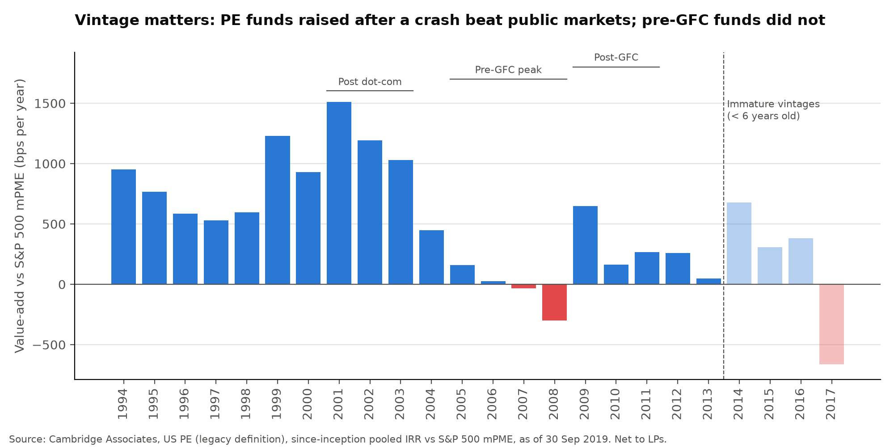
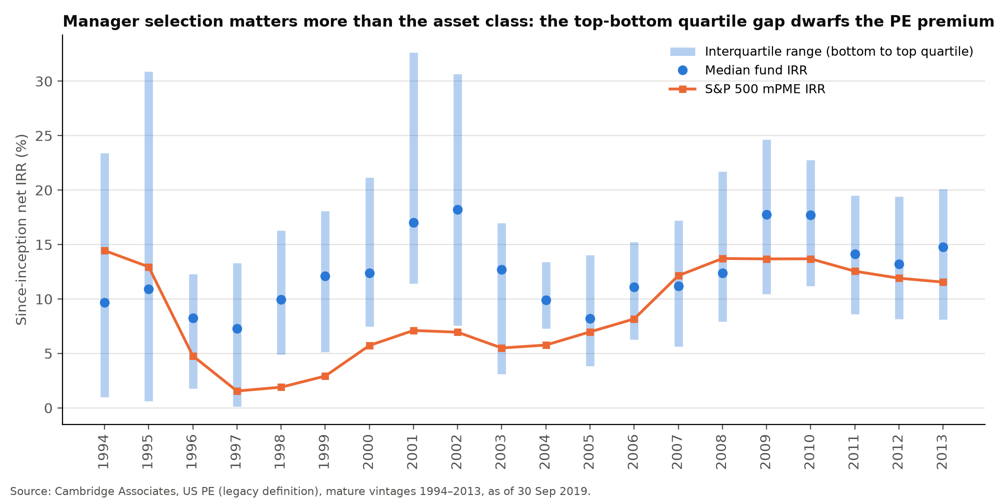

# When Does Private Equity Pay Off?
### US private equity vs public equities and bonds, 1994–2026

**Samy Hassairi** · EDHEC Business School, Finance & Data Analytics · November 2026

📄 **[Read the investment memo (PDF)](06_report/PE_vs_Public_Markets_Memo_2026.pdf)**

---

## Key findings

| | Finding |
|---|---|
| **Long run** | Over 25 years, US PE returned 12.76% a year, vs 8.74% for the S&P 500 and 6.18% for Baa corporate bonds. |
| **Measured like-for-like** | Against the same cash flows invested in the Russell 3000 (mPME), the 25-year PE premium is +273 bps a year, just below the c. 3-point hurdle many pension funds use. |
| **Short run** | Over 1 to 5 years, PE trailed US public equities (Russell 3000, mPME) by 228 to 1,196 bps a year. |
| **Vintage matters** | Funds raised after the dot-com crash (2001–2003) beat the S&P 500 mPME by c. 1,240 bps a year; funds raised at the pre-GFC peak (2005–2008) slightly lagged it. |
| **The manager matters most** | The gap between top- and bottom-quartile funds averaged 14.1 points a year, about 2.5 times the average PE value-add (5.5 points). |
| **Measurement matters** | Against the same index, a naive IRR-vs-index comparison misstates the PE premium by up to 1.5 points a year. |

## Method

- **Public assets:** geometric annualised returns (CAGR) computed from annual total returns, 1928–2025.
- **Private equity:** pooled IRR, net of fees and carried interest, from Cambridge Associates benchmark reports.
- **Like-for-like comparison:** Cambridge Associates' modified Public Market Equivalent (mPME), which invests each fund's cash flows in a public index on the same dates.
- **Cross-check:** every horizon return is computed twice, in Excel and in Python, with identical results.

## Repository structure

| Folder | Content |
|---|---|
| `01_data_raw` | Download links for the source reports (files not included, copyright) |
| `02_data_clean` | Cleaned public market returns (CSV) |
| `03_excel` | Excel model: inputs, horizon returns, naive vs mPME comparison |
| `04_python` | Notebooks: `01_horizon_analysis` (returns by horizon), `02_vintage_analysis` (PDF table extraction, vintage and dispersion analysis) |
| `05_outputs` | Charts |
| `06_report` | Investment memo (PDF) |

## How to reproduce

1. Download the three source files listed in [`01_data_raw/README.md`](01_data_raw/README.md) and save them in `01_data_raw`.
2. Install the dependencies: `pip install -r requirements.txt`
3. Run the notebooks in order: `01_horizon_analysis.ipynb`, then `02_vintage_analysis.ipynb`.

**Tools:** Excel · Python (pandas, NumPy, Matplotlib, pdfplumber) · Jupyter

## Data sources

- Cambridge Associates, *US Private Equity Benchmark Book*, Q1 2026 (as of 31 Mar 2026)
- Cambridge Associates, *US Private Equity (Legacy Definition) Benchmark Book*, Q3 2019 (as of 30 Sep 2019)
- A. Damodaran, NYU Stern, *Historical Returns on Stocks, Bonds and Bills, 1928–2025* (updated 5 Jan 2026)
- Harris, Jenkinson, Kaplan & Stucke, *Has Persistence Persisted in Private Equity?*, NBER Working Paper 28109 (2020)

## Limitations

PE valuations are appraisals, not market prices; returns are not risk-adjusted for leverage; vintage data stop in September 2019; the 2019 and 2026 reports use different fund definitions. See section 5 of the memo for details.

## Log

- 29 Oct 2026 – Environment setup, folder structure, Cambridge Associates Q1 2026 report downloaded.
- 1 Nov 2026 – Damodaran data downloaded. Excel model built. Notebook 01: horizon returns, charts 01–02.
- 9 Nov 2026 – Cambridge Associates Q3 2019 report downloaded. Notebook 02: PDF table extraction, vintage and dispersion analysis, charts 03–04.
- 9 Nov 2026 – Investment memo finalised and published.